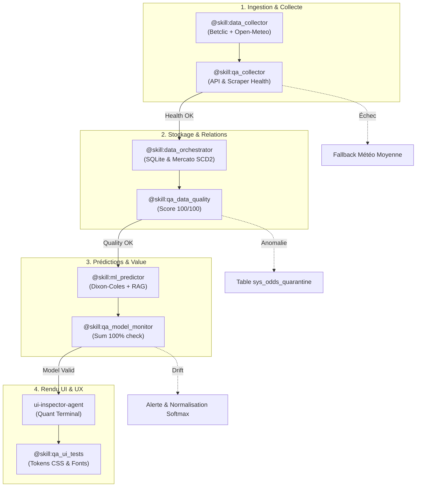

# 🛠️ Antigravity Skills Guide — Predictor Ultimate

> [!NOTE]
> **Format Optimisé Panneau Latéral (Side-Panel / Split Editor)**  
> Ce guide est structuré pour une consultation fluide en écran scindé (`Ctrl+\` ou `Cmd+\`) dans **Antigravity IDE** ou **Antigravity 2.0**. Les sections techniques et les sorties JSON étendues sont repliables (`<details>`) pour une navigation compacte et ergonomique.

---

## ⚡ Navigation Rapide (TOC)

| Catégorie | Skill | Rôle Clé | Invocation Directe |
| :--- | :--- | :--- | :--- |
| **Pipeline Data** | [`data_collector`](#1-skill-data_collector) | Météo Open-Meteo (89 stades) & Cotes Betclic | `@skill:data_collector` |
| **Data Eng.** | [`data_orchestrator`](#2-skill-data_orchestrator) | Schémas SQLite & Suivi Mercato SCD Type 2 | `@skill:data_orchestrator` |
| **Intelligence** | [`ml_predictor`](#3-skill-ml_predictor) | Multi-modèles v1/v2/v3, Value Bets & RAG | `@skill:ml_predictor` |
| **Contrôle Qualité** | [`qa_collector`](#4-skill-qa_collector) | Disponibilité API Open-Meteo & latence | `@skill:qa_collector` |
| **Contrôle Qualité** | [`qa_data_quality`](#5-skill-qa_data_quality) | Intégrité SCD2 & audit complet (/100) | `@skill:qa_data_quality` |
| **Contrôle Qualité** | [`qa_model_monitor`](#6-skill-qa_model_monitor) | Normalisation $\sum P \approx 100\%$ & xG | `@skill:qa_model_monitor` |
| **Contrôle Qualité** | [`qa_ui_tests`](#7-skill-qa_ui_tests) | Typographies & tokens design Bloomberg Quant | `@skill:qa_ui_tests` |
| **Prompt Eng.** | [`brainstorming`](#8-skill-brainstorming) | Reformulation, Grill-Me & Sauvegarde Draft | `@brainstorming` |
| **Orchestration** | [Workflows Multi-Agents](#-intégration-dans-un-workflow-multi-agents) | Portes de qualité et contrats inter-agents | `/teamwork-preview` |

---

## 🚀 Modes d'Appel & Syntaxe dans Antigravity

Dans Antigravity, chaque skill dispose de **4 mécanismes d'invocation complémentaires** :

```text
┌────────────────────────────────────────────────────────────────────────┐
│ 1. Mention Interactive       : @skill:<nom_du_skill> dans le prompt chat│
│ 2. Détection Contextuelle    : Déclenchement automatique par le modèle │
│ 3. Délégation Multi-Agents   : invoke_subagent / send_message          │
│ 4. Exécution CLI / Terminal  : Exécution directe en ligne de commande  │
└────────────────────────────────────────────────────────────────────────┘
```

1. **Mention Interactive (`@skill:<nom>`)** :
   Force le chargement immédiat du manifeste `SKILL.md` dans la fenêtre d'attention de l'agent.
   *Exemple :* `@skill:ml_predictor Prédis PSG vs Marseille avec cote domicile 1.65`

2. **Détection Contextuelle (Natural Prompt)** :
   Antigravity indexe la description de chaque skill. Dès que la requête exprime une intention couverte (ex: *"donne la météo du stade"*, *"vérifie le club d'un joueur"*), le skill est injecté dynamiquement.

3. **Délégation Multi-Agents (Subagents)** :
   Un agent coordinateur orchestre un agent spécialisé via l'API `invoke_subagent` ou lui envoie un message structuré via `send_message`.

4. **Exécution CLI Déterministe** :
   Chaque script sous `.agents/skills/<skill>/scripts/` est exécutable directement depuis le terminal ou via l'outil `run_command`.

---

## 📚 Catalogue Détaillé des Skills

---

### 1. Skill `data_collector`
> **Badge :** `[DATA INGESTION]` `[LEAGUES]` `[WEATHER]` `[ODDS]`  
> **Identifiant Unique :** `skill.data_collector`  
> **Agent Affilié :** `data-orchestrator-agent`

#### 🎯 Rôle & Périmètre
Automatise la collecte des données périphériques pour les **5 grands championnats européens** et les **Coupes d'Europe (LDC, EL, ECL)** :
- **Météo des Stades** : Connexion à l'API Open-Meteo pour **230+ stades géolocalisés** (`src/data/stadiums_master.json`).
- **Résolution Rigoureuse** : Statut explicite `is_certified_stadium: true/false` sans fallback trompeur vers Paris.
- **Cotes Bookmaker** : Intégration des extracteurs Betclic furtifs (1N2, Over/Under, Buteurs).

#### ⌨️ Syntaxe d'Invocation (4 Formes)
- **1. Mention Chat :** `@skill:data_collector Récupère la météo du prochain match de Liverpool à Anfield.`
- **2. Prompt Naturel :** *"Quelles sont les conditions météo prévues pour le match de Paris ?"*
- **3. Délégation Sous-Agent :**
  ```json
  {
    "Recipient": "data-orchestrator-agent",
    "Message": "{\"action\": \"collect_weather\", \"team\": \"Liverpool\", \"date\": \"2026-10-24\"}"
  }
  ```
- **4. Exécution CLI :**
  ```bash
  python .agents/skills/data_collector/scripts/fetch_weather.py --team "Liverpool" --date "2026-10-24"
  ```

#### 📥 Paramètres d'Entrée (`fetch_weather.py`)
| Argument | Type | Requis / Défaut | Description |
| :--- | :--- | :--- | :--- |
| `--team` | `string` | Optionnel (`"PSG"`) | Nom du club hôte (230+ stades couverts). |
| `--date` | `string` | Optionnel (`today`) | Date du match au format `YYYY-MM-DD`. |
| `--output`| `string` | Optionnel (`None`) | Chemin de fichier pour enregistrer le JSON. |

<details>
<summary><b>📤 Exemple de Sortie Testée (JSON) — Cliquez pour dérouler</b></summary>

```json
{
  "team": "PSG",
  "city": "Paris",
  "stadium": "Parc des Princes",
  "country": "France",
  "date": "2026-10-24",
  "is_certified_stadium": true,
  "weather": {
    "weather_code": 80,
    "condition": "Slight Rain Showers",
    "temp_avg_c": 11.2,
    "temp_max_c": 13.5,
    "temp_min_c": 8.9,
    "precipitation_mm": 17.7,
    "wind_speed_kmh": 27.9
  }
}
```
</details>

#### 🛡️ Stratégie d'Erreur & Fallback
Si l'API Open-Meteo est inaccessible ou subit un timeout réseau, le script bascule automatiquement sur les normales saisonnières (`temp_avg_c: 18.5`, `condition: "Partly Cloudy"`, code 2). Pour les clubs non répertoriés, les coordonnées restent `null` avec `is_certified_stadium: false` sans fausser la localisation.

---

### 2. Skill `data_orchestrator`
> **Badge :** `[DATABASE]` `[SQLITE]` `[SCD TYPE 2]` `[MERCATO]`  
> **Identifiant Unique :** `skill.data_orchestrator`  
> **Agent Affilié :** `data-orchestrator-agent`

#### 🎯 Rôle & Périmètre
Gère l'infrastructure relationnelle SQLite (`predictor_v2.db`) et le cycle de vie temporel des joueurs et équipes :
- **Suivi Mercato SCD Type 2** : Historisation stricte des affiliations (`valid_from`, `valid_to`, `is_current`) garantissant l'absence de réécriture destructive lors des transferts (ex: Cherki, Marmoush).
- **Maintien des Schémas Dimensionnels & Faits** : `dim_teams`, `dim_players`, `dim_player_contracts_scd2`, `fact_matches`, `fact_odds_snapshots`.

#### ⌨️ Syntaxe d'Invocation (4 Formes)
- **1. Mention Chat :** `@skill:data_orchestrator Applique le transfert de Marmoush vers Manchester City au 2026-07-01.`
- **2. Prompt Naturel :** *"Enregistre le transfert de joueur et vérifie son club historique."*
- **3. Délégation Sous-Agent :**
  ```json
  {
    "Recipient": "data-orchestrator-agent",
    "Message": "{\"action\": \"transfer_player\", \"player_id\": \"marmoush_01\", \"to\": \"MAN_CITY\", \"date\": \"2025-07-01\"}"
  }
  ```
- **4. Exécution CLI :**
  ```bash
  python .agents/skills/data_orchestrator/scripts/manage_mercato.py --transfer --player "marmoush_01" --to "MAN_CITY" --date "2025-07-01"
  python .agents/skills/data_orchestrator/scripts/init_database.py
  ```

#### 📥 Paramètres d'Entrée (`manage_mercato.py`)
| Argument | Type | Requis / Défaut | Description |
| :--- | :--- | :--- | :--- |
| `--transfer` | `flag` | Optionnel (`False`) | Exécute la transaction de transfert SCD2. |
| `--player` | `string` | Optionnel (`"marmoush_01"`) | Identifiant unique du joueur. |
| `--to` | `string` | Optionnel (`"MAN_CITY"`) | Identifiant de l'équipe de destination. |
| `--date` | `string` | Optionnel (`"2025-07-01"`) | Date d'effet (`YYYY-MM-DD`). |
| `--check` | `flag` | Optionnel (`False`) | Consulte l'équipe du joueur à la date cible. |

<details>
<summary><b>📤 Exemple de Sortie Testée (Console) — Cliquez pour dérouler</b></summary>

```text
Marmoush team on 2025-05-01: Eintracht Frankfurt
Mercato SCD2 Success: Player marmoush_01 transferred to team MAN_CITY effective 2025-07-01.
Marmoush historical team on 2025-05-01 (must stay Eintracht): Eintracht Frankfurt
Marmoush current team on 2026-01-01 (must be Man City): Manchester City
```
</details>

#### 🛡️ Stratégie d'Erreur & Fallback
Si la base de données ou les tables requises sont absentes, `get_db_connection()` auto-crée les schémas via `CREATE TABLE IF NOT EXISTS`. En cas de transaction interrompue, SQLite rollback l'opération pour préserver la cohérence des affiliations actives (`is_current = 1`).

---

### 3. Skill `ml_predictor`
> **Badge :** `[MACHINE LEARNING]` `[DIXON-COLES]` `[VALUE BET]` `[RAG]`  
> **Identifiant Unique :** `skill.ml_predictor`  
> **Agent Affilié :** `data-orchestrator-agent` / Subagent ML

#### 🎯 Rôle & Périmètre
Moteur quantitatif Football Quant Engine V3 et raisonnement contextuel :
- **Multi-modèles v1 / v2 / v3** : Dixon-Coles Bivariate Poisson, LightGBM calibré et dé-vigging Shin.
- **Détecteur de Value Bets** : Comparaison probabilités modèle vs cotes implicites dé-viggées ($Edge > 5\%$).
- **Dimensionnement Kelly Fractionnaire** : Calcul de la mise optimale prudente ($f^* \le 5\%$).
- **Synthèse RAG Contextuelle** : Justification en langage naturel incluant forme, météo, arbitre et absents.

#### ⌨️ Syntaxe d'Invocation (4 Formes)
- **1. Mention Chat :** `@skill:ml_predictor Prédis PSG vs Marseille avec cote 1.65 à domicile.`
- **2. Prompt Naturel :** *"Calcule les probabilités 1N2 et cherche les Value Bets pour le match PSG - OM."*
- **3. Délégation Sous-Agent :**
  ```json
  {
    "Recipient": "ml-predictor-subagent",
    "Message": "{\"action\": \"predict_match\", \"home\": \"PSG\", \"away\": \"Marseille\", \"odd_home\": 1.65, \"odd_draw\": 4.10, \"odd_away\": 5.50}"
  }
  ```
- **4. Exécution CLI :**
  ```bash
  python .agents/skills/ml_predictor/scripts/predict_match.py --home "PSG" --away "Marseille" --odd_home 1.65 --odd_draw 4.10 --odd_away 5.50
  python .agents/skills/ml_predictor/scripts/rag_engine.py --home "PSG" --away "Marseille"
  ```

#### 📥 Paramètres d'Entrée (`predict_match.py`)
| Argument | Type | Requis / Défaut | Description |
| :--- | :--- | :--- | :--- |
| `--home` | `string` | Optionnel (`"PSG"`) | Club domicile (alias reconnus: om, ol, real, barca...). |
| `--away` | `string` | Optionnel (`"Marseille"`) | Club extérieur. |
| `--odd_home` | `float` | Optionnel (`1.65`) | Cote Betclic Domicile (1). |
| `--odd_draw` | `float` | Optionnel (`4.10`) | Cote Betclic Nul (N). |
| `--odd_away` | `float` | Optionnel (`5.50`) | Cote Betclic Extérieur (2). |
| `--temp` | `float` | Optionnel (`21.0`) | Température en °C. |
| `--rain` | `float` | Optionnel (`0.0`) | Précipitations en mm. |
| `--wind` | `float` | Optionnel (`12.0`) | Vitesse du vent en km/h. |
| `--referee` | `string` | Optionnel (`"Clément Turpin"`) | Nom de l'arbitre principal. |
| `--h_absent` | `int` | Optionnel (`0`) | Nombre d'absents équipe domicile. |
| `--a_absent` | `int` | Optionnel (`0`) | Nombre d'absents équipe extérieure. |

<details>
<summary><b>📤 Exemple de Sortie Testée (`rag_engine.py`) — Cliquez pour dérouler</b></summary>

```json
{
  "query": "Prédiction PSG vs Marseille",
  "timestamp": "2026-10-24 00:08:16",
  "match_details": {
    "home": "PSG",
    "away": "Marseille",
    "stadium": "Parc des Princes",
    "city": "Paris",
    "date": "2026-10-24"
  },
  "weather_context": {
    "condition": "Slight Rain Showers",
    "temp_c": "11.2°C",
    "rain_mm": "17.7 mm",
    "wind_kmh": "27.9 km/h"
  },
  "model_probabilities": {
    "home_win": "56.4%",
    "draw": "23.5%",
    "away_win": "20.2%"
  },
  "top_score_exact": "1-0 (11.8%)",
  "value_bets": [
    {
      "selection": "2",
      "side": "Victoire Extérieur",
      "odd": 5.5,
      "edge": "+11.1%",
      "kelly_stake_pct": "0.62%"
    }
  ],
  "natural_language_justification": "Basé sur notre modèle Dixon-Coles et l'analyse contextuelle RAG :\n1. Dominance à domicile : PSG affiche un xG projeté de 1.75 contre 0.95 pour Marseille à Parc des Princes.\n2. Impact Météo : Conditions actuelles à Paris (Slight Rain Showers, 11.2°C, Vent 27.9 km/h).\n3. Value Bet : Une opportunité de Value Bet est identifiée sur Victoire Extérieur avec une cote Betclic de 5.5 (Edge : +11.1%)."
}
```
</details>

#### 🛡️ Stratégie d'Erreur & Fallback
Si les artefacts LightGBM ou les cotes dynamiques sont inaccessibles, le script bascule automatiquement sur le modèle heuristique Dixon-Coles Bivariate Poisson V1 (`home_xg: 1.8`, `away_xg: 1.1`, probabilités normalisées 55%/25%/20%) sans générer d'exception bloquante.

---

### 4. Skill `qa_collector`
> **Badge :** `[QA MONITORING]` `[API HEALTH]` `[SCRAPER AUDIT]` `[MULTI-PROBE]`  
> **Identifiant Unique :** `skill.qa_collector`  
> **Agent Affilié :** `data-orchestrator-agent`

#### 🎯 Rôle & Périmètre
Surveillance multi-sondes de disponibilité, intégrité des registries et connectivité des extracteurs :
- **Sonde 1 — Open-Meteo API** : Disponibilité, conformité du schéma JSON et latence milliseconde.
- **Sonde 2 — Stack Betclic Puppeteer** : Validation de l'environnement Node.js, des plugins furtifs et de la résolution DNS de Betclic.
- **Sonde 3 — Stadium Registry Master** : Certification de plus de 230 stades géolocalisés sans coordonnées corrompues.

#### ⌨️ Syntaxe d'Invocation (4 Formes)
- **1. Mention Chat :** `@skill:qa_collector Vérifie l'état de santé du collecteur météo et des scrapers.`
- **2. Prompt Naturel :** *"L'API météo et l'environnement de scraping Betclic répondent-ils normalement ?"*
- **3. Délégation Sous-Agent :**
  ```json
  {
    "Recipient": "data-orchestrator-agent",
    "Message": "{\"action\": \"check_collector_health\"}"
  }
  ```
- **4. Exécution CLI :**
  ```bash
  python .agents/skills/qa_collector/scripts/check_collector_health.py
  ```

#### 📥 Paramètres d'Entrée (`check_collector_health.py`)
| Argument | Type | Requis / Défaut | Description |
| :--- | :--- | :--- | :--- |
| *(Aucun)* | N/A | Exécution directe | Diagnostic 3-en-1 (Open-Meteo, Puppeteer Betclic, Registre 230+ stades). |

<details>
<summary><b>📤 Exemple de Sortie Testée (JSON) — Cliquez pour dérouler</b></summary>

```json
{
  "timestamp": "2026-10-24 00:40:35",
  "open_meteo": {
    "status": "OK",
    "latency_ms": 241.56,
    "details": "Open-Meteo API functional"
  },
  "betclic_extractor": {
    "status": "OK",
    "latency_ms": 477.06,
    "puppeteer_ready": true,
    "dns_resolution": "RESOLVED",
    "details": "Puppeteer stealth stack ready and DNS reachable"
  },
  "stadium_registry": {
    "status": "OK",
    "venues_count": 231,
    "details": "Registry certified (231 venues loaded)"
  },
  "overall_status": "HEALTHY"
}
```
</details>

#### 🛡️ Stratégie d'Erreur & Fallback
Si l'une des 3 sondes échoue de manière critique, le script lève `overall_status: "DEGRADED"` et retourne le code de sortie `sys.exit(1)`, incitant l'agent orchestrateur à basculer sur les données en cache local.

---

### 5. Skill `qa_data_quality`
> **Badge :** `[SQL AUDIT]` `[SCD2 INTEGRITY]` `[DUPLICATE CHECK]`  
> **Identifiant Unique :** `skill.qa_data_quality`  
> **Agent Affilié :** `data-orchestrator-agent`

#### 🎯 Rôle & Périmètre
Contrôle qualité automatisé sur la base de données relationnelle `predictor_v2.db` et l'écosystème JSON :
- Valide qu'aucun joueur n'a d'affiliations multiples actives (`is_current = 1`) dans `dim_player_contracts_scd2`.
- Vérifie la validité des plages de dates (`valid_from <= valid_to`).
- Audite l'écosystème global (`app_data.json`, `unified_history.json`, `players.json`) et calcule un score de santé `/100`.

#### ⌨️ Syntaxe d'Invocation (4 Formes)
- **1. Mention Chat :** `@skill:qa_data_quality Lance un audit complet d'intégrité de la base de données.`
- **2. Prompt Naturel :** *"Vérifie les doublons SCD2 et le score de qualité des données."*
- **3. Délégation Sous-Agent :**
  ```json
  {
    "Recipient": "data-orchestrator-agent",
    "Message": "{\"action\": \"audit_data_quality\"}"
  }
  ```
- **4. Exécution CLI :**
  ```bash
  python .agents/skills/qa_data_quality/scripts/check_data_quality.py
  node .agents/skills/qa_data_quality/scripts/audit_complete_ecosystem.cjs
  ```

#### 📥 Paramètres d'Entrée
| Script | Type | Requis / Défaut | Description |
| :--- | :--- | :--- | :--- |
| `check_data_quality.py` | CLI Python | Direct | Audit SQL SCD2 des affiliations et dates. |
| `audit_complete_ecosystem.cjs` | CLI Node.js | Direct | Audit des fixtures, effectifs et score /100. |

<details>
<summary><b>📤 Exemples de Sorties Testées (Console / JSON) — Cliquez pour dérouler</b></summary>

**Sortie Python SQL (`check_data_quality.py`) :**
```json
{
  "status": "PASSED",
  "anomalies_found": 0,
  "warehouse_metrics": {
    "scd2_table": "dim_player_contracts_scd2",
    "total_contracts": 11365,
    "active_contracts": 3262,
    "competitions_seeded": 8,
    "analytical_indices_verified": 5
  },
  "details": []
}
```

**Sortie Node.js Global (`audit_complete_ecosystem.cjs`) :**
```text
🤖 Agent QA Data Quality — Audit d'Intégrité Global en Cours...

====================================================
📊 RAPPORT DE QUALITÉ DES DONNÉES - SCORE : 100/100
====================================================
 Status : EXCELLENT
 Erreurs critiques : 0
 Avertissements : 0
 Matchs Totaux : 2148
 Matchs Historique : 5057
 Joueurs Modélisés : 5913
 Clubs avec Roster : 126
====================================================
```
</details>

#### 🛡️ Stratégie d'Erreur & Fallback
Si des anomalies sont identifiées, le script retourne `exit code 1` avec la liste exacte des IDs compromis. Les cotes aberrantes sont automatiquement réorientées vers la table de mise à l'écart `sys_odds_quarantine`.

---

### 6. Skill `qa_model_monitor`
> **Badge :** `[ML MONITORING]` `[PROBABILITY INTEGRITY]` `[DATA DRIFT]`  
> **Identifiant Unique :** `skill.qa_model_monitor`  
> **Agent Affilié :** `data-orchestrator-agent` / Subagent ML

#### 🎯 Rôle & Périmètre
Validation des contraintes probabilistes et détection du Data Drift :
- S'assure que $\sum P(1N2) \approx 100\%$ avec une tolérance stricte ($|Total - 100| \le 2\%$).
- Interdit les probabilités négatives ou nulles anormales.
- Vérifie la positivité stricte des espérances de buts ($xG \ge 0$).

#### ⌨️ Syntaxe d'Invocation (4 Formes)
- **1. Mention Chat :** `@skill:qa_model_monitor Contrôle la cohérence des distributions 1N2 générées.`
- **2. Prompt Naturel :** *"Vérifie que les probabilités du modèle somment bien à 100%."*
- **3. Délégation Sous-Agent :**
  ```json
  {
    "Recipient": "ml-predictor-subagent",
    "Message": "{\"action\": \"check_model_health\"}"
  }
  ```
- **4. Exécution CLI :**
  ```bash
  python .agents/skills/qa_model_monitor/scripts/check_model_health.py
  ```

#### 📥 Paramètres d'Entrée (`check_model_health.py`)
| Argument | Type | Requis / Défaut | Description |
| :--- | :--- | :--- | :--- |
| *(Aucun)* | N/A | Exécution directe | Teste la cohérence des probabilités et espérances. |

<details>
<summary><b>📤 Exemple de Sortie Testée (JSON) — Cliquez pour dérouler</b></summary>

```json
{
  "status": "PASSED",
  "sum_check_total": "100.0%",
  "v3_bundle_ready": true,
  "real_scorers_resolved": true,
  "warehouse_calibration": {
    "v1": { "predictions_count": 2148, "brier_score": 0.6407, "log_loss": 1.062 },
    "v2": { "predictions_count": 2148, "brier_score": 0.6157, "log_loss": 1.0262 },
    "v3": { "predictions_count": 2148, "brier_score": 0.6182, "log_loss": 1.0321 }
  },
  "issues": []
}
```
</details>

#### 🛡️ Stratégie d'Erreur & Fallback
En cas d'anomalie de somme ($>2\%$) ou de valeur négative, le script lève une alerte critique (`exit code 1`). L'agent coordinateur applique alors une normalisation Softmax sur les logits bruts avant toute restitution utilisateur.

---

### 7. Skill `qa_ui_tests`
> **Badge :** `[FRONTEND AUDIT]` `[CSS TOKENS]` `[BUILD VERIFICATION]`  
> **Identifiant Unique :** `skill.qa_ui_tests`  
> **Agent Affilié :** `ui-inspector-agent` / `ux-auditor-agent`

#### 🎯 Rôle & Périmètre
Vérifie la conformité de l'interface utilisateur (React 18 / Vite / Tailwind), des routes Cockpit et des contrats JSON :
- Vérifie la présence des typographies du design system (`Inter`, `JetBrains Mono`) et des tokens Bloomberg Zinc Quant (`--obsidian`, `--gold`, `--positive`).
- Audite l'intégrité des **7 vues lazy-loaded** du Cockpit (`DailyBettingHub`, `MatchDeepDive`, `LeagueFocusHub`, `MatchHistoryHub`, `SquadsMercatoProps`, `CopilotView`, `BankrollTracking`) dans `src/App.jsx`.
- Valide les contrats de données JSON (`app_data.json`, `analytics_cache.json`, `stadiums_master.json`, `model_backtest_report.json`) et surveille le poids des bundles.

#### ⌨️ Syntaxe d'Invocation (4 Formes)
- **1. Mention Chat :** `@skill:qa_ui_tests Vérifie les contrats de style et l'intégrité du build frontend.`
- **2. Prompt Naturel :** *"Contrôle que les tokens CSS et polices Quant sont conformes."*
- **3. Délégation Sous-Agent :**
  ```json
  {
    "Recipient": "ui-inspector-agent",
    "Message": "{\"action\": \"verify_ui_contracts\"}"
  }
  ```
- **4. Exécution CLI :**
  ```bash
  python .agents/skills/qa_ui_tests/scripts/verify_ui_build.py
  ```

#### 📥 Paramètres d'Entrée (`verify_ui_build.py`)
| Argument | Type | Requis / Défaut | Description |
| :--- | :--- | :--- | :--- |
| *(Aucun)* | N/A | Exécution directe | Inspecte `index.html` et `src/index.css`. |

<details>
<summary><b>📤 Exemple de Sortie Testée (JSON) — Cliquez pour dérouler</b></summary>

```json
{
  "status": "PASSED",
  "issues": []
}
```
</details>

#### 🛡️ Stratégie d'Erreur & Fallback
Si des tokens obligatoires manquent, le rapport liste les variables défaillantes et permet à l'agent UI d'injecter automatiquement les variables CSS de secours dans `:root`.

---

### 8. Skill `brainstorming`
> **Badge :** `[PROMPT ENG]` `[GRILL-ME]` `[DECISION-TREE]` `[DRAFTS]`  
> **Identifiant Unique :** `skill.brainstorming`  
> **Agent Affilié :** `skills-doc-agent` / `Cognitive Loop Antigravity`

#### 🎯 Rôle & Périmètre
Transforme une demande brute en un prompt de production ultra-structuré grâce aux meilleures pratiques de Prompt Engineering :
- **Reformulation & Enrichissement** : Structure [RÔLE], [CONTEXTE], [TÂCHES], [CONTRAINTES] et [FORMAT DE SORTIE].
- **Routine Grill-Me** : Pose 3 à 5 questions ciblées pour traquer les angles morts et arbitrages non tranchés.
- **Menu d'Action Final** : Propose un choix entre `[1] Exécuter`, `[2] Mettre de côté (draft)`, ou `[3] Oublier`.

#### ⌨️ Syntaxe d'Invocation (4 Formes)
- **1. Mention Chat :** `@brainstorming Crée un script d'audit des tables SQLite.` (ou `@skill:brainstorming`)
- **2. Prompt Naturel :** *"Aide-moi à brainstormer et enrichir un prompt pour scraper les cotes."*
- **3. Délégation Sous-Agent :**
  ```python
  invoke_subagent(
      Role="Prompt Strategist",
      TypeName="self",
      Prompt="@brainstorming Définis le prompt système de l'agent de scoring des value bets."
  )
  ```
- **4. Exécution CLI :**
  ```bash
  python .agents/skills/brainstorming/scripts/save_draft.py --name "audit_sqlite" --content "Prompt optimisé..."
  ```

#### 📥 Paramètres d'Entrée (`save_draft.py`)
| Argument | Type | Requis / Défaut | Description |
| :--- | :--- | :--- | :--- |
| `--name` | `string` | Requis | Nom descriptif du prompt (ex: `audit_sqlite`). |
| `--content` | `string` | Requis | Contenu texte complet du prompt enrichi. |
| `--tags` | `string` | `"brainstorming"` | Tags séparés par des virgules pour classification. |
| `--dir` | `string` | `".agents/drafts"` | Répertoire de destination du markdown généré. |

<details>
<summary><b>📤 Exemple de Sortie Testée (Sauvegarde Draft) — Cliquez pour dérouler</b></summary>

```text
DRAFT_SAVED:C:\Users\benoi\Documents\Predictor Ultimate\.agents\drafts\draft_20261024_000833_audit_sqlite.md
```
</details>

#### 🛡️ Stratégie d'Erreur & Fallback
Si la création du dossier ou du fichier échoue (problème de permissions), la skill affiche le contenu directement dans le chat avec le format de secours pour que l'utilisateur puisse le copier-coller manuellement sans perte d'information.

---

## 🔄 Intégration dans un Workflow Multi-Agents

Dans une architecture multi-agents moderne, ces 7 skills s'enchaînent selon un pipeline déterministe avec **portes de qualité strictes (Quality Gates)** :



### 💡 4 Bonnes Pratiques d'Orchestration

1. **Pattern Quality-Gate Avant Inférence :**
   Toujours invoquer `qa_data_quality` avant de déclencher `ml_predictor`. Cela élimine le risque d'inférer sur des données d'affiliations orphelines.

2. **Format de Contrat Standardisé Inter-Agents :**
   Lorsqu'un agent délègue une tâche via `send_message`, utilisez toujours une enveloppe JSON stricte :
   ```json
   {
     "from_agent": "data-orchestrator-agent",
     "target_skill": "ml_predictor",
     "action": "predict_match",
     "payload": {
       "home": "Arsenal",
       "away": "Chelsea",
       "odds": [1.95, 3.60, 4.20]
     }
   }
   ```

3. **Circuit-Breaker & Fallback Silencieux :**
   Si l'API Open-Meteo subit un timeout (`qa_collector` alerte), le skill `data_collector` applique automatiquement les coordonnées moyennes du stade sans bloquer le pipeline prédictif global.

4. **Maintenance Automatisée de la Documentation :**
   L'agent [`skills-doc-agent`](file:///.agents/agents/skills_doc_agent.md) inspecte tout ajout de script dans `.agents/skills/*/scripts/` et assure la synchronisation permanente de ce guide.
